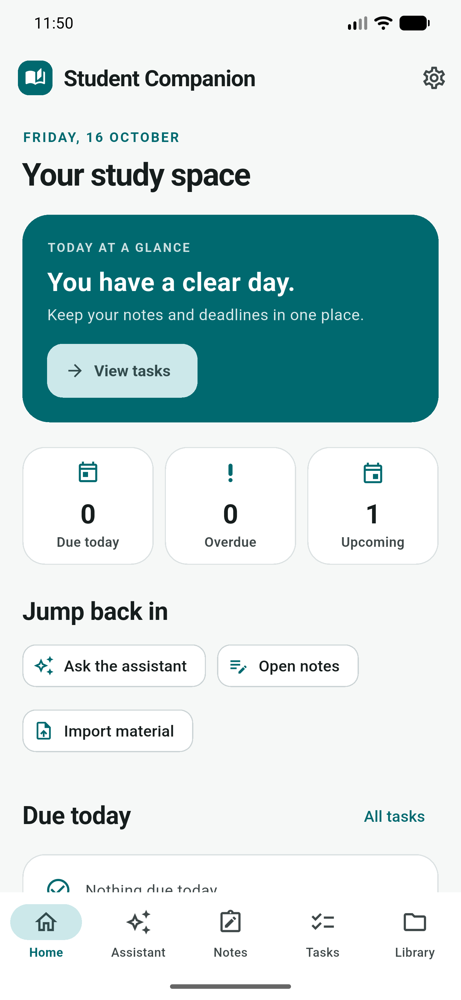
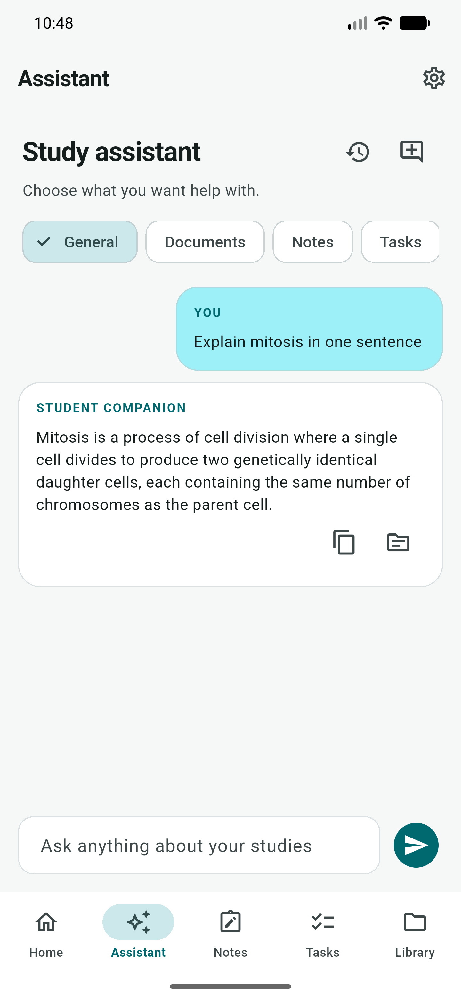
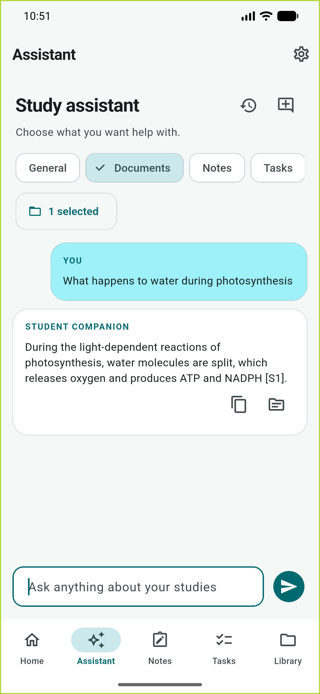
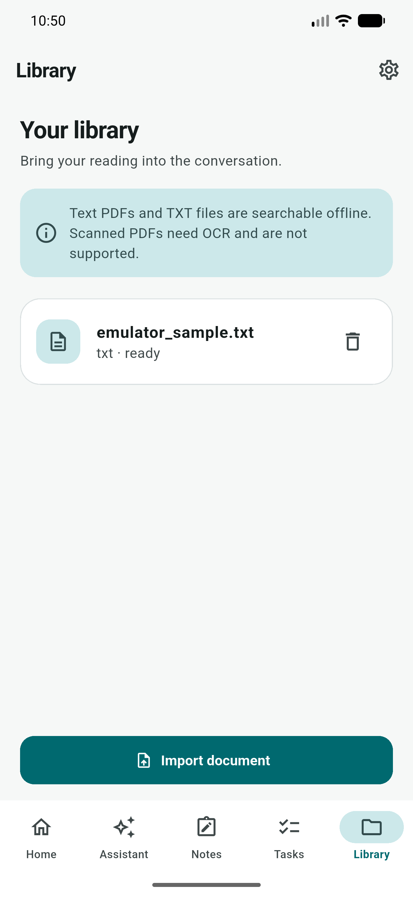
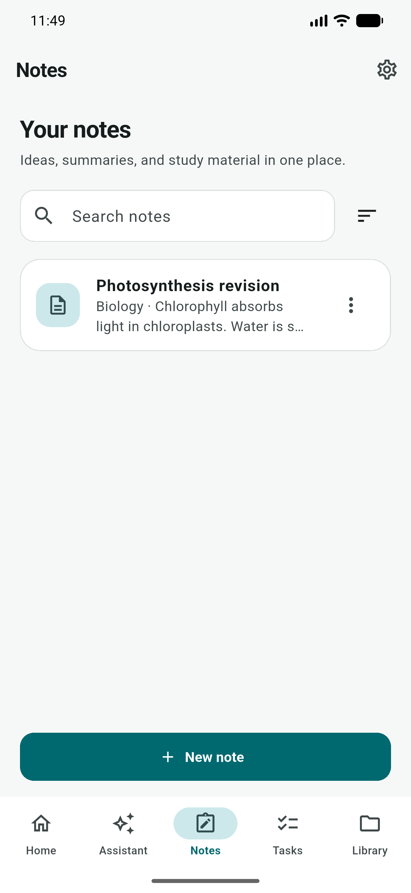
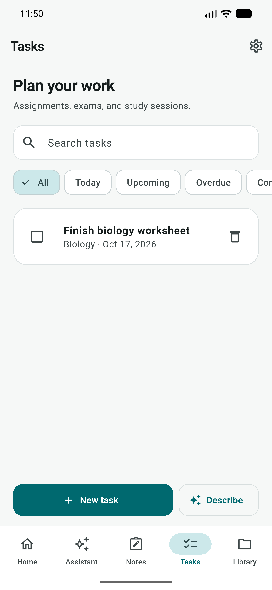
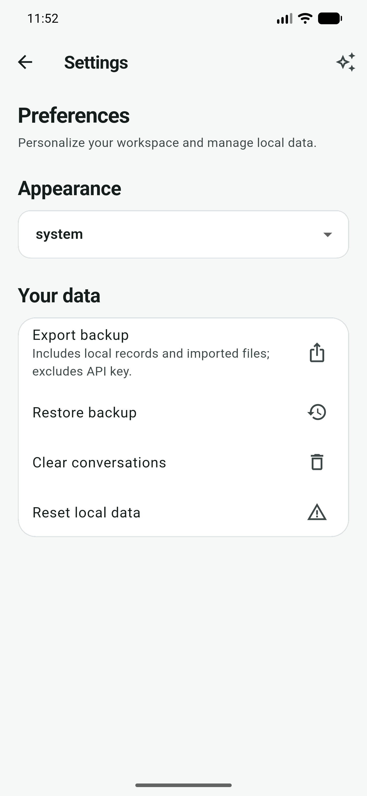
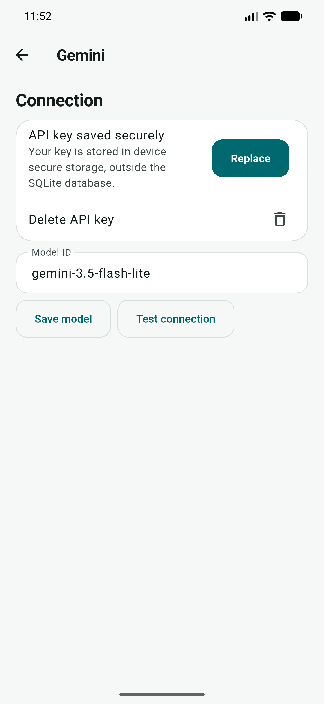

# Student Companion

One place for the small things that make up a study day: notes, deadlines, reading, and the questions that come up along the way.

Student Companion is a single-user Flutter app for Android. Your notes, tasks, chats, and imported files stay on your device. When you choose to ask the AI assistant a question, the app connects directly to Google's Gemini API using a key you provide.

## A look around

These screenshots are from the Android emulator. The sample biology note and task are there to show what a study day looks like in the app.

| Home | Assistant |
| --- | --- |
|  |  |
| See today's workload and pick up where you left off. | Ask a general study question and return to saved chats. |

| Documents | Library |
| --- | --- |
|  |  |
| Ask about imported reading and inspect the cited excerpts. | Keep text PDFs and TXT files ready for questions. |

| Notes | Tasks |
| --- | --- |
|  |  |
| Save, search, pin, and revisit ideas. | Track assignments, exams, and study sessions. |

| Settings | Gemini setup |
| --- | --- |
|  |  |
| Choose a theme, export a backup, or restore your data. | Open the sparkle icon in Settings to manage your key and model. |

## What you can do

- **Plan your day.** Home shows tasks due today, overdue, and coming up, plus recent notes. Tasks can have a date without a time.
- **Keep useful notes.** Write and organize notes by subject and tags. AI writing actions show a preview before changing a note.
- **Ask and revisit.** Assistant conversations are saved locally. Notes and task drafts from a chat open in an editable form, so you decide what gets saved.
- **Read with context.** Import a text-based PDF or TXT file, then ask a question in Documents mode. Answers link back to the excerpts used.
- **Take your data with you.** Export or restore a local backup from Settings. The backup includes your study data and imported files, but never your Gemini key.

Saved material remains available offline. AI replies need an internet connection and a valid Gemini API key.

## Run it locally

You need Flutter 3.44 or later, an Android SDK, and an Android device or emulator.

```bash
flutter pub get
flutter run
```

The welcome screen takes you straight into the app. To use AI features, open **Settings → sparkle icon** to add your own Gemini API key, test the connection, or choose a model. The local `.env` file is ignored by Git and is not bundled into the app.

To build a debug APK, run `flutter build apk --debug`. The file will be at `build/app/outputs/flutter-apk/app-debug.apk`.

## Data and limits

The app has no account, server, or sync service. SQLite stores notes, tasks, chats, and document indexes; imported files stay in the app's local documents directory. The Gemini key is kept in Android secure storage, separate from the database. A question sent to Gemini may include the text you typed and, in Documents mode, relevant excerpts from your imported files. Confirm before sending private material.

Imports support TXT and text-based PDFs up to 10 MB and 500,000 extracted characters. Scanned PDFs need OCR and are not supported here. DOCX, reminders, and cross-device sync are also outside this version. Backups contain personal study material, so store them somewhere you trust.

## Working on the app

The Flutter code lives in `lib/`: shared database and Gemini services are under `lib/core`, with screens grouped under `lib/features`. Run `flutter analyze` and `flutter test test` before opening a change. Android flow tests are in `integration_test/`.

The Android package still uses a starter application ID and debug signing. Set your own ID and release signing before distributing an APK.
